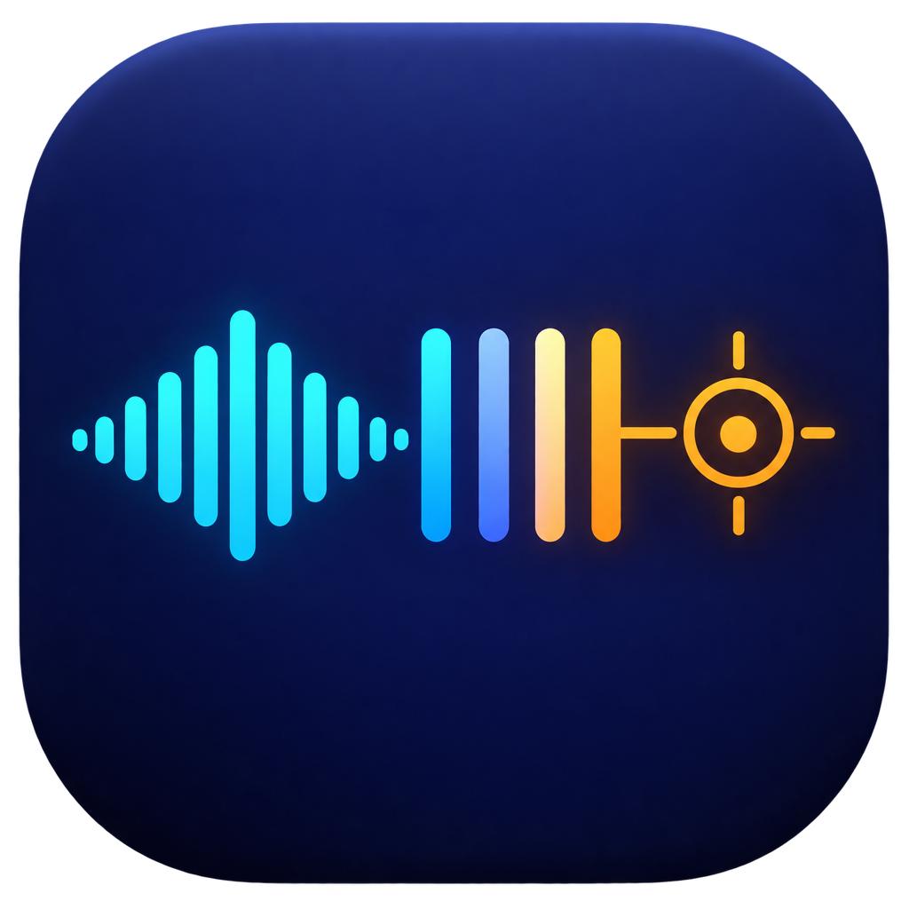

# RateCue

<p align="center">
  
</p>

[](https://github.com/troylefevre65/RateCue/actions/workflows/check.yml)
[](LICENSE)

**Track what Apple Music reports—and see which parts RateCue can verify.** RateCue is a macOS menu bar app and command-line toolkit for monitoring sample rate and bit depth without confusing source format with the selected DAC setting.

### At a glance

- Observe Apple Music rate changes quickly from the menu bar.
- Correlate Music's Lossless panel and playback evidence with explicit provenance.
- Keep the track format, selected output setting, active route, and bit-perfect status separate.
- Reveal engineering and statistical detail only when opening **Advanced Diagnostics**.
- Reproduce behavior through a CLI designed for repeatable automated checks.

RateCue is for listeners who want trustworthy visibility into lossless playback and for developers or hardware reviewers who need inspectable evidence rather than a single opaque indicator.

**Status: development preview.** The packaged build has no qualified output configurations or calibrated sensor profiles. It cannot automatically switch catalog playback. A controlled Eitr 2 lab trial demonstrated rate changes with known local ALAC fixtures; it did not establish general catalog switching or bit-perfect playback.

## What the display means

| Display | Meaning |
| --- | --- |
| Green `96k / 24` | RateCue accepted qualified source-format evidence, currently the authorized local file header when it agrees with Music's reported track rate. This does not verify output samples. |
| Amber `≈96k / —` | Music reports a sample rate, but RateCue has not established that it describes the active rendition. The bit depth is unknown. Estimates never trigger device writes. |
| Amber `≈96k / 24` | A Music Lossless-panel snapshot explicitly showed 24-bit depth. It remains unverified and clears on playback, route, or reported-rate changes. |
| Neutral `— / —` | No current source format is available. |

Correlated bit depth is a separate amber estimate. It starts from provisional, uncalibrated rate-conditioned priors (44.1 kHz: 70% 16-bit / 30% 24-bit; 88.2/96/176.4 kHz: 30% / 70%; 192 kHz: 5% / 95%; otherwise 50% / 50%), then updates the candidate probabilities with bounded evidence likelihood weights. Music panel and Music log/decoder observations share one independence family, so only the strongest non-conflicting weight from that family is multiplied; duplicate influences remain visible with zero log-odds effect. Accepted observations persist only within the unchanged playback context. Prior-only formats retain their probabilities but always withhold an estimate. A candidate is published only when accepted evidence exists, its posterior is at least 90%, and no conflict exists. These provisional model outputs are not calibrated confidence claims, never qualify source format, and never trigger a device write.

The menu's **Status** describes alignment using qualified evidence. It can say **Unknown Format** while an amber estimate is visible. Neither a device's configured rate nor a DAC LED establishes source bit depth. No display color proves bit-perfect playback.

### Current detection baseline

The development preview reads Music's reported rate and correlates decoder-log
observations for an estimated depth; the optional Music panel can supply
additional unverified evidence. The experimental LLM and MCP helper are not
on the detection or switching path.

In a small follow-up listening session, depth appeared 1.4–1.7 seconds after
the first accepted playback sample for six of seven observed track changes;
one remained unknown for 106 seconds. These timings do not establish the
actual playback start or the source format. The Back-twice improvement passed
regression tests and log replay but has not yet been confirmed live. See the
[listening results and remaining hazards](MCP-PLAN.md#monitored-listening-session).

## Build and run

Requires macOS 15 or later, Xcode 16 or later with its command-line tools selected, and Swift 6 or later. Music is needed for live playback tests, not the automated test suite. A DAC is optional for monitoring and required only for relevant hardware trials.

```sh
sh Scripts/check.sh
```

This validates the packaging plists, runs the Swift tests, then builds and verifies `dist/RateCue.app`. When available, it uses the `RateCue Local Development` code-signing identity so macOS permission grants remain stable across rebuilds; setting `DAMON_SIGN_IDENTITY` selects another identity. On a machine without either identity, it falls back to ad-hoc signing and rebuild permissions may change. The development build is not sandboxed or notarized. Quit the old app before opening the rebuilt bundle. The bundle identifier (`org.damon.BitStreamManager`) remains unchanged for preference compatibility; the CLI executable is named `RateCue`.

Set `RATECUE_BUILD_DIR` when running the check to build and verify a separate
bundle without replacing an existing app.

Open RateCue from Finder, start Music, and enable **Monitor Apple Music** in the menu bar. Handle the macOS Automation prompt if shown. Select a preferred output under **Select Output Device**; RateCue remembers its UID but does not change the system output route. For local-file source-format evidence, open **Advanced Diagnostics** and choose **Choose Authorized Local Audio**.

## Music panel estimates

For a manual estimate, open Music's Lossless panel on the current track and choose **Music Evidence → Read Open Music Lossless Panel…**. Alternatively, choose **Music Evidence → Read Fresh Music Lossless Panel…**, then manually open the badge when RateCue prompts you. The timed fresh-panel workflow has timed out in a live trial. Both manual checks only read the interface. An open panel can retain the previous track's format, and even a newly opened panel is not proven to describe the delivered rendition.

For experimental automatic estimates, enable **Music Evidence → Automatically Read Music Panel (Experimental)**. Leave Music's Now Playing view available. After playback, route, or reported-rate changes, RateCue opens and reads a closed Lossless panel, or closes and reopens an existing panel to establish freshness, including while Music is active. It restores the open state when a panel was already open. While depth remains unknown, it retries periodically. Existing snapshots remain visible until those changes invalidate them. Turning off monitoring or automatic panel reading cancels an in-flight automatic read, which can leave the panel closed or open during an interrupted interaction. Failed checks appear under **Advanced Diagnostics**.

Panel reading requires Accessibility access and a recognizable Music Now Playing layout and ALAC format text. It may fail with other layouts or localizations. If depth is omitted, ambiguous, or conflicts with Music's track rate, RateCue leaves it unknown. Panel estimates stay amber and never authorize device changes. Live automatic snapshots have been displayed, but same-rate 16/24-bit attribution has not been independently qualified.

Use **Music Evidence → Accessibility Access…** to check or request access for the running build. In **System Settings → Privacy & Security**, the setting is called **Device Control and Data Access** on the test Mac; other macOS versions may call it **Accessibility**. The app can read Music's interface, and the optional automatic reader also interacts with its panel.

## Command line

The bundled executable is also a CLI:

```sh
ratecue=./dist/RateCue.app/Contents/MacOS/RateCue
"$ratecue" --version
"$ratecue" --help
"$ratecue" devices
"$ratecue" status
"$ratecue" menu-status
"$ratecue" probe-format
```

| Command | Purpose and effects |
| --- | --- |
| `devices`, `--diagnose` | List output capabilities; `devices` returns JSON. Neither changes audio settings. |
| `config show`, `config set ...` | Read or change RateCue preferences, not the system output route. The experimental panel option is set in the menu. |
| `authorize-music` | Explicitly request Music Automation permission for the CLI launcher. Music must already be running. |
| `status`, `check --rate <Hz> --depth <bits> [--device <uid-or-name>]` | Read a fresh qualified source and route observation. Amber menu estimates are not included. `check` returns 0 for a match, 1 for mismatch or unavailable evidence, and 2 for invalid invocation. |
| `menu-status` | Read the running menu app's latest title, 16/24-bit posterior probabilities, evidence state, candidate, provenance, conflict/prior flags, and automatic-panel status from a local atomic JSON snapshot. It does not interact with Music or audio hardware. |
| `probe-format [--panel\|--fresh-panel]` | Read unqualified Music evidence without changing playback or the device. `--panel` reads an open panel; `--fresh-panel` waits for the user to open it. |
| `playback <play\|pause\|next>` | Send a Music playback command. |
| `--make-qualification-kit <new-folder>`, `--make-fixtures <new-folder>` | Generate synthetic audio files in a new directory. The qualification kit also compares each ALAC file with its PCM reference. |
| `test-fixture --kit <folder> [--device <uid-or-name>] [--allow-interrupt]` | Play and check a known local fixture. It can alter Music's playback and queue but does not write the DAC rate. |
| `test-switch --kit <folder> --device <uid-or-name> --allow-rate-write` | Play fixtures and change the selected device rate in an explicitly authorized hardware trial. It attempts, but cannot guarantee, a guarded return to baseline. |
| `--compare-pcm <reference> <candidate> [--offset-frames <N>]` | Compare complete stereo sample windows offline without opening Music or an audio device. |

The `menu-status` payload is versioned and reproducible. It includes the schema/model versions, millisecond timings from the current playback observation boundary for rate and published-depth detection, prior percentages, unrounded 24-bit posterior, and ordered contributions—including the rate prior—showing every influence, candidate, strength label, provisional likelihood ratio, and signed log-odds effect. Redundant same-family evidence is retained diagnostically with a zero effect. **Advanced Diagnostics → Copy Diagnostics** renders the same timing and contribution data rather than a summary-only subset.

### Experimental first-track diagnostic pilot

For a deliberately opted-in capture, launch a built menu executable **without
arguments** with `RATECUE_FIRST_TRACK_TRACE=1` in its environment. This does not
enable Music monitoring, permissions, panel interaction, or switching. Do not
launch a second menu instance; use the trace-enabled build only when ready.
The default remains off.

The pilot keeps only redacted observations in memory. While nothing is playing
it holds a rolling pre-roll (64 events or 30 seconds), so the app can idle
indefinitely before playback. From the first accepted playing sample it keeps
up to 512 events or 120 seconds.

Launch through LaunchServices so macOS attributes permissions to RateCue, then
let the CLI do the rest:

```sh
open --env RATECUE_FIRST_TRACK_TRACE=1 dist/RateCue.app
"$ratecue" first-track-trace capture first-track.json   # restarts capture, waits for playback
```

`capture` waits up to ten minutes (`--timeout-s`) for playback to start and
cover the deadline, then writes the trace and prints its assessment. Start
playback yourself, or with `"$ratecue" playback play` when Music has something
queued. `first-track-trace restart`, `stop` and `export [<file>]` do the
steps separately; the first track after a restart stays buffered until the
next restart, so it can be exported later.

The same actions are in the menu: **Advanced Diagnostics → Copy First-Track
Trace (Experimental)** copies JSON to the clipboard, **Restart First-Track
Capture** drops the buffer and waits for the next playback start, and
**Delete First-Track Trace / Stop Capture** drops the buffer; app exit also
deletes it. Remove the launch flag to disable future capture. Clipboard history
and saved exports must be deleted separately; no trace is automatically saved.

Offline assessment requires no running menu app, Music, hardware, or model:

```sh
"$ratecue" assess-first-track first-track.json --deadline-ms 10000
```

It reports separate outcomes and delays for Music's reported rate, the computed
display depth and device alignment, plus indexed observed facts, never an
invented root cause. Add `--timeline` for a compact row-per-event rendering.
The deadline starts at the first accepted playing observation after **capture
start**, not independently observed playback onset; captures started mid-track
are not actual listening-session-first-track cases. A trace that ends before
the deadline remains inconclusive. Late outcomes are retrospective.
This pilot is a diagnostic prerequisite, **not an agent evaluation**;
live resource overhead and diagnostic usefulness are unmeasured.
See the [trace contract](MCP-SPECIFICATION.md#implemented-first-track-observation-pilot-experimental)
and [remaining pilot gates](MCP-PLAN.md#implemented-prerequisite-and-next-gates).

### Automating the menu app

Every menu function has a CLI entry point, so scripts and test harnesses never
need the menu or the clipboard. Commands that need the running app talk to it
over a local request/response channel:

```sh
"$ratecue" app diagnostics             # the Copy Diagnostics text, plus access state
"$ratecue" app qualification-snapshot  # the Qualification Snapshot as JSON
"$ratecue" app logs                    # the session log
"$ratecue" app login-item [status|on|off]
"$ratecue" app quit
"$ratecue" config set --auto-read-panel on|off --camera-verification on|off --relay-verification on|off
"$ratecue" --credits
```

The verification options do not request camera or microphone access; grant
that in the menu first. Any process running as you can use this channel, just
as it can run the CLI. The full function-to-command table is in the
[automation interface](MCP-SPECIFICATION.md#automation-interface).

### Experimental MCP adapter

The optional separately launched helper is
`dist/RateCue.app/Contents/MacOS/RateCueMCP`. Configure that fixed bundle
executable as a stdio MCP server in a compatible host; no arguments or
environment override are needed. The helper does not start RateCue or Music.
Remove the host configuration to disable it; rebuilding, moving, or removing
the app can break the configured path.

By default the helper offers four read-only tools:

- `ratecue_get_diagnostics`: the redacted menu snapshot.
- `ratecue_get_settings`: on/off preferences; device and local-audio choices
  only as present or absent.
- `ratecue_get_qualification_snapshot`: playback state, displayed source rate
  and depth, preferred device rate.
- `ratecue_get_first_track_assessment`: delays, facts, rule hypothesis and
  timeline for the current first-track capture.

Launching the helper with `RATECUE_MCP_ALLOW_CONTROL=1` adds four control
tools: `ratecue_playback` (play, pause, next), `ratecue_set_preference`
(Monitor Music, Auto Switch, Show Rate, Show Depth),
`ratecue_restart_first_track_capture` and `ratecue_stop_first_track_capture`.
No tool writes audio hardware, selects a device, or returns device names,
paths, titles or free-form text. Leave control off for a model-driven host
unless you accept that a model can misuse it.

Scripts can call the helper without a model:

```sh
python3 Scripts/mcp-call.py list
python3 Scripts/mcp-call.py ratecue_get_first_track_assessment '{"deadlineMilliseconds": 10000}'
python3 Scripts/mcp-call.py --control ratecue_playback '{"command": "pause"}'
```

The helper supports MCP versions `2025-11-25` and `2025-06-18`; for another
requested version it offers `2025-11-25` and the client must decide
compatibility. The diagnostics tool reads only the standard menu snapshot,
not `RATECUE_DIAGNOSTICS_DIR`. Missing, stale, future-dated, unsafe,
unsupported, or inconsistent snapshots produce errors. Correlated depth is
unverified and scores are uncalibrated; there is no transition history or
benchmark data.

The file and process checks do not authenticate a same-user writer or rule
out PID reuse. Stdio does not make the host, model, transcript storage, or
other tools private or offline; verify them separately. No model is bundled.
This adapter and its integration are experimental:
host compatibility, live privacy, resource budgets and diagnostic usefulness
have not been qualified. See the [adapter contract](MCP-SPECIFICATION.md#first-release-scope)
and [development plan](MCP-PLAN.md).

#### Local agent experiment

Ollama and its models are separate from the app and are not automatically
started. With a trusted local Ollama installation and a model installed, start
the service in one terminal:

```sh
OLLAMA_HOST=127.0.0.1:11434 OLLAMA_NO_CLOUD=1 OLLAMA_NUM_PARALLEL=1 ollama serve
```

In another terminal, with the RateCue menu app already running:

```sh
python3 Scripts/local-agent.py 'Call ratecue_get_diagnostics now and explain only supported observations.'
```

By default the development host uses the loopback Ollama API, launches the bundled
read-only MCP helper, and asks the model to call its one tool. It prefers the
standard `dist/RateCue.app` helper; if absent, it uses the separately built
`dist/LocalAgentPilot/RateCue.app` helper. Build either with
`sh Packaging/build-app.sh` or `RATECUE_BUILD_DIR=dist/LocalAgentPilot sh Packaging/build-app.sh`;
each command replaces the app bundle at its selected destination, so quit
that app first. Stop the foreground Ollama service with Ctrl-C when finished.
For a trace explicitly copied and saved by the user, offline analysis is:

```sh
python3 Scripts/local-agent.py --trace first-track.json --deadline-ms 10000
```

Add `--model <name>` to try another installed model. The host runs the fixed
bundled CLI's bounded, validated offline assessment and sends only its typed
assessment and timeline—not the file or its path—to the local model. It prints:

- `ruleHypothesis`: one label from a closed list of delay mechanisms, chosen by
  a documented decision list applied mechanically.
- `agentHypothesis`: the model's label, the timeline rows it says it found,
  and `misread`, the rows it got wrong when checked against the timeline.

Both labels are hypotheses consistent with the trace, not proven causes.
Use the deterministic assessment as a starting point, not a verified
explanation. On synthetic traces with a known injected mechanism, the best
model tested on the M2 scored 11 of 30; the remote 27B model scored 18 of 30
without thinking, and a frontier model given the same cases scored 30 of 30.
This does not establish accuracy on real playback. Reproduce the local run with:

```sh
python3 Scripts/evaluate-agent.py --split heldout --per-category 3 --models qwen3:4b,phi4-mini
```

To run the model on another machine you control, add `--server` to either
script, and `--api openai` when that server speaks the OpenAI-compatible API
(llama.cpp, LM Studio and similar) instead of Ollama's own:

```sh
python3 Scripts/evaluate-agent.py --split heldout --per-category 3 \
    --server http://model-host.local:8080 --api openai --models MODEL_NAME
python3 Scripts/local-agent.py --trace first-track.json --server http://model-host.local:8080 --api openai --model MODEL_NAME
```

RateCue, the MCP helper and the trace stay on this Mac; only the typed
assessment and timeline, or the redacted snapshot, are sent, and the script
prints a note naming the destination. Use `--max-tokens` for models that
think before answering, and `RATECUE_LLM_API_KEY` if the server needs a key.
The OpenAI-compatible path sends the `chat_template_kwargs.enable_thinking`
extension; the server must support or ignore that extension. In the
evaluation script, append `+think` to a model name to enable thinking.
Such servers usually have no authentication of their own: limit them to
this Mac's address in the other machine's firewall.

To check against a frontier model, export the unlabeled cases, have that model
answer them, and score its answers with the same row checks. RateCue ships no
network client or credentials; where the files go is your choice.

```sh
python3 Scripts/evaluate-agent.py --split heldout --per-category 3 --export-cases cases/
python3 Scripts/evaluate-agent.py --split heldout --per-category 3 --score-answers cases/frontier.jsonl
python3 Scripts/local-agent.py --trace first-track.json --export-prompt prompt.json   # one real trace
python3 Scripts/local-agent.py --trace first-track.json --check-answer answer.json
```

The exported prompt for a real trace contains only the typed assessment and
timeline: numbers and enumerated words, no titles, device names or paths.

See the [evaluation results](MCP-PLAN.md#synthetic-trace-reading-evaluation).
This path does not use MCP, collect the trace, or control playback. Results
may include retrospective after-deadline outcomes and are not suitable for
blinded accuracy scoring. Localhost does not authenticate a pre-existing
service; use a trusted service and verify its configuration. Live performance
and offline behavior have not been qualified.

While Music is monitored, RateCue performs bounded unified-log backfill attempts per playback epoch. It starts with two fast queries, then uses widening 250 ms, 750 ms, 1.5 s, 3 s, 6 s, and 12 s retry gaps so late decoder records are not mistaken for missing evidence. It requires current Music/Core Media decoder reports to match playback timing and reported rate; process failures use longer backoff. Lifecycles too close in time to tell apart prevent attribution only when they report different depths, and a lifecycle RateCue already attributed to a different track is not reused for the next one, so pressing Back twice no longer leaves the depth blank. A queued item that Music starts early is accepted once its decoder report arrives at the playback boundary. These timing heuristics do not prove track identity: in particular, a stale playback position immediately after a skip can misplace the lifecycle anchor. A pause or idle interval retains the current track's original decoder-lifecycle anchor so resuming does not shift the log query by paused wall-clock time; a replay from the beginning resets it. The parser is versioned and replay-tested, and accepted log evidence appears as `decoderLog` with its actual contribution.

For reproducible local input, generate the kit in a **new** directory:

```sh
"$ratecue" --make-qualification-kit dist/QualificationKit
"$ratecue" --compare-pcm \
  dist/QualificationKit/PCM/Damon-96000Hz-24bit.wav \
  dist/QualificationKit/ALAC/Damon-96000Hz-24bit.m4a
```

See the [test plan](PLAN.md#cli-configuration-and-tests) for configuration syntax, permission setup, trial preconditions, exit codes, and examples. CLI device and configuration output can contain device UIDs or local paths; redact it before sharing.

## Troubleshooting

- **Music Automation denied:** grant access under **Privacy & Security → Automation**. The bundled app and terminal-launched CLI may require separate grants; `authorize-music` requests access for the CLI.
- **Accessibility enabled but RateCue reports denied:** check **Music Evidence → Accessibility Access…** for the running build. Development builds should use the persistent `RateCue Local Development` signing identity; if a different identity was used, restore that identity before reauthorizing the exact `RateCue.app`.
- **Automatic depth waits or shows `—`:** Music must be playing with Now Playing available. The automatic reader can reopen an open panel or briefly open a closed panel, even while Music is active. Check **Advanced Diagnostics** for failures.
- **Preferred device unavailable or route unconfirmed:** reconnect or select the intended device and check Music's actual output. RateCue does not silently select a replacement or reroute audio.
- **Sensors unavailable:** camera and microphone verification requires a valid calibrated profile and separate permission; the packaged profile list is empty.

Use **Advanced Diagnostics → Copy Diagnostics** for a status summary designed to omit track titles, paths, and device identifiers. **Advanced Diagnostics → Qualification Snapshot…** can copy or save a separate JSON report of qualified source evidence and output names; it does not include amber estimates. Review reports and system error text for sensitive information before sharing. Development builds have no configured updater.

## Versions and development

The app and bundled CLI use `CFBundleShortVersionString` and `CFBundleVersion` in [`Packaging/Info.plist`](Packaging/Info.plist). About and `"$ratecue" --version` read the same values. Update both deliberately for a release; the build scripts do not increment them and have no independent version numbers. Script changes are tracked with the project revision.

The menu's **About RateCue**, **Help**, and **Credits** entries show the installed version and build, usage and build guidance, and project attribution.

## Project guide

- [Specification](SPECIFICATION.md): observable behavior, confidence model, privacy boundaries, and release criteria.
- [Development and test plan](PLAN.md): CLI cookbook, lab procedures, measured results, and outstanding qualification gates.
- [Proposed local agent and MCP adapter](MCP-SPECIFICATION.md): staged evaluation of diagnostics and format estimation, with a [development plan](MCP-PLAN.md).
- [Contributing](CONTRIBUTING.md): development workflow and what to include in a report or proposed change.

## License and credits

RateCue is licensed under [GNU GPL v3 only](LICENSE) (`GPL-3.0-only`). It is a separate clean-room project inspired by [LosslessSwitcher 3.0-beta1](https://github.com/vincentneo/LosslessSwitcher/releases/tag/3.0-beta1), by **Vincent Neo and the LosslessSwitcher contributors**. See [NOTICE](NOTICE) for the exact upstream revision and license. RateCue is not affiliated with Apple or the LosslessSwitcher project.
